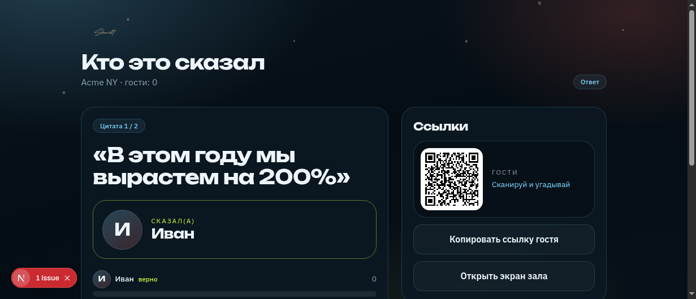
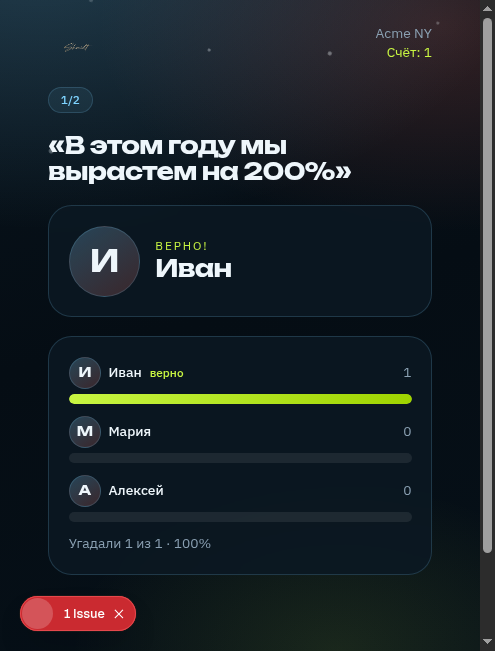
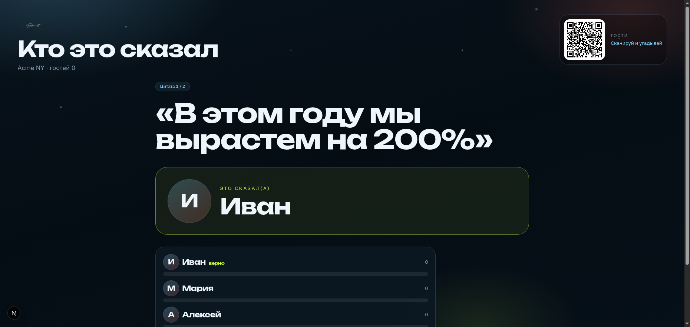

# Кто это сказал

Новогодний корп-интерактив: ведущий загружает цитаты и авторов, гости угадывают «кто это сказал», экран зала показывает огромную цитату, ответ и статистику.

## Роли

- **Ведущий** — создаёт игру, вставляет цитаты пачкой, добавляет фото авторов, управляет раундами.
- **Гость** (телефон) — выбирает автора из вариантов.
- **Экран зала** — крупная цитата, таймер, reveal, топ.

## Запуск локально

```bash
cd next-app
npm install
env -u DATABASE_URL npm run dev
```

Откройте http://127.0.0.1:3000

Без `DATABASE_URL` работает in-memory PGlite. На Cursor Cloud Apps платформа поднимает Postgres.

## Формат цитат

```
В этом году вырастем на 200% — Иван
С Новым годом, команда! — Мария
```

Также: `цитата,Автор` или `цитата|Автор`.

## Токены

- Host / guest session / screen — в `Authorization: Bearer` или `sessionStorage`, экран: `#s=…` (hash).
- В QR гостя только access-ключ `?k=` (не session token).

## Publish

Папка публикации: `next-app/` (`cursor-app.json` → Postgres).

Лого: `brand/logo.png` и `next-app/public/brand/logo.png`. Instagram в футере кликабелен.

## Скрины






